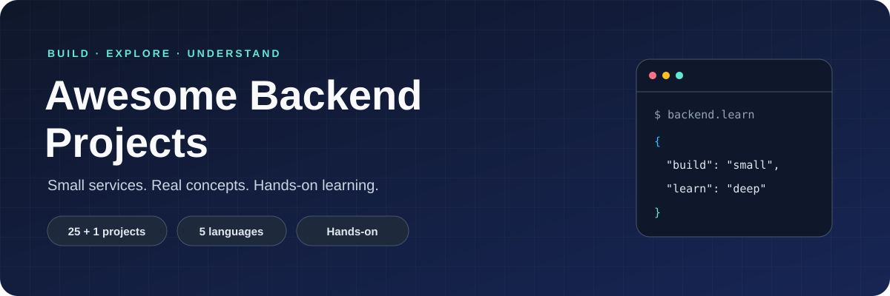

	

<h1 align="center">Awesome Backend Projects</h1>

	Learn backend engineering by exploring small, independently runnable services. 
	<strong>25 projects + 1 bonus · 5 languages · Hands-on learning</strong>

	
	
	
	
	

	<a href="#-quick-start">🚀 Quick start</a> ·
	<a href="#-project-catalog">📂 Project catalog</a> ·
	<a href="#-testing">🧪 Testing</a> ·
	<a href="./CONTRIBUTING.md">🤝 Contributing</a> ·
	<a href="./SECURITY.md">🛡️ Security</a> ·
	<a href="./LICENSE">📄 License</a> ·
	<a href="https://github.com/zpratikpathak/Awesome-25-Backend-Projects/issues">💬 Issues</a>

## 📖 Overview

A hands-on collection spanning HTTP APIs, authentication, scheduling, real-time communication, media tooling, and distributed-system concepts. Each folder is a separate project: choose one, read its documentation, and run it without installing a language runtime on your machine.

### ✨ What's included

- **Independent projects:** separate source code, dependencies, and startup instructions.
- **Container-first execution:** a `Dockerfile` and `.dockerignore` in every project.
- **Runnable checks:** regression or smoke tests for implemented behavior.
- **Local documentation:** project README, centered SVG logo, configuration, and known limits.
- **Multiple ecosystems:** JavaScript/Node.js, Python, Go, Rust, and Java.

## 🚀 Quick start

**Prerequisites:** Docker with Linux-container support. Git is optional if you download the repository as a ZIP. Builds need internet access to retrieve images and dependencies.

1. Clone or download [this repository](https://github.com/zpratikpathak/Awesome-25-Backend-Projects).
2. Open a project folder and read its `README.md` for configuration and routes.
3. Build and run its container using the documented commands. Install no project dependencies on the host.

Start with [URL Shortener](./01-url-shortener/README.md), [Todo API](./02-todo-api/README.md), or [Random Quote API](./09-random-quote-api/README.md). Each is a small introduction to request validation and API behavior.

Projects run individually, not as one application. Many reuse the same ports; run one at a time or select different host ports. Keep demo services bound to localhost.

## 📂 Project catalog

Project names describe learning topics. The scope column states what the current implementation actually provides; individual READMEs contain endpoint details and limitations.

| # | Project | Language | Current scope |
| --- | --- | --- | --- |
| 01 | [URL Shortener](./01-url-shortener/README.md) | JavaScript | Create short links and redirect requests |
| 02 | [Todo API](./02-todo-api/README.md) | Python | Manage todos with validated API requests |
| 03 | [Weather API Wrapper](./03-weather-api-wrapper/README.md) | Go | Wrap weather-provider requests and errors |
| 04 | [Markdown to HTML Converter](./04-markdown-to-html-converter/README.md) | Rust | Convert Markdown to sanitized HTML |
| 05 | [Simple Chat Server](./05-simple-chat-server/README.md) | JavaScript | Multi-client chat and message broadcasts |
| 06 | [File Metadata Microservice](./06-file-metadata-microservice/README.md) | JavaScript | Validate uploads and return file metadata |
| 07 | [Basic Auth System](./07-basic-auth-system/README.md) | JavaScript | Registration, password checks, and tokens |
| 08 | [Expense Tracker API](./08-expense-tracker-api/README.md) | Java | Create and list validated expenses |
| 09 | [Random Quote API](./09-random-quote-api/README.md) | Python | Create quotes and retrieve random entries |
| 10 | [Task Scheduler](./10-task-scheduler/README.md) | JavaScript | Schedule tasks with cron expressions |
| 11 | [Blog CMS API](./11-blog-cms-api/README.md) | JavaScript | Create and list blog posts |
| 12 | [Real-time Polling App](./12-real-time-polling-app/README.md) | Go | Create and list polls; no live voting yet |
| 13 | [E-commerce Catalog](./13-ecommerce-catalog/README.md) | JavaScript | Serve a static product catalog |
| 14 | [Image Processing API](./14-image-processing-api/README.md) | Python | Preview image-request metadata; no transformation |
| 15 | [Discord Bot for Stats](./15-discord-bot-stats/README.md) | Python | Report Discord guild statistics |
| 16 | [Web Scraper API](./16-web-scraper-api/README.md) | JavaScript | Extract page content with URL validation |
| 17 | [Redis Cache Layer](./17-redis-cache-layer/README.md) | JavaScript | Demonstrate caching with an in-memory simulation |
| 18 | [Rate Limiter Middleware](./18-rate-limiter-middleware/README.md) | Go | Limit requests by client IP |
| 19 | [Notification Service](./19-notification-service/README.md) | JavaScript | Simulate asynchronous notification jobs |
| 20 | [Video Metadata Extractor](./20-video-metadata-extractor/README.md) | JavaScript | Extract local video metadata with ffprobe |
| 21 | [Distributed Key-Value Store](./21-distributed-key-value-store/README.md) | Go | Store values and demonstrate peer replication |
| 22 | [Microservices Communication](./22-microservices-communication/README.md) | JavaScript | Client/server communication over gRPC |
| 23 | [Real-time Collaborative Editor](./23-real-time-collaborative-editor/README.md) | JavaScript | Synchronize document updates over WebSockets |
| 24 | [Search Engine Indexer](./24-search-engine-indexer/README.md) | Go | Index documents and search matching terms |
| 25 | [Blockchain Ledger](./25-blockchain-ledger/README.md) | Python | Demonstrate mining and hash-linked blocks |
| Bonus | [Monitoring Dashboard API](./26-monitoring-dashboard-api/README.md) | JavaScript | Expose process metrics and request measurements |

## 🏗️ Repository layout

Each numbered folder contains its own entrypoint, source files, dependency manifest, Docker configuration, README, logo, and tests. Layouts follow the language or framework in use; there is no shared application runtime.

## 🧪 Testing

The latest verification in this development session passed **26 of 26 container regression checks**. This is a recorded result, not a live CI badge or a guarantee of exhaustive coverage.

- Run the test command in the project's README after making changes.
- Keep dependency installation, compilation, startup checks, and tests inside containers.
- Regression containers use external networking disabled where supported; local client/server tests still use loopback.
- API-key integrations use mocked calls. Tests require no real weather or Discord credentials and do not verify live-provider access.
- Startup checks and regression tests establish implemented demo behavior, not production readiness.

## 🛡️ Known limits and security

These services are learning examples. Several keep state in memory, so a restart loses data. Some named integrations are simulations, as noted in the catalog. Do not assume persistent storage, complete CRUD operations, authorization, distributed consistency, or production monitoring unless a project explicitly implements them.

**Do not expose these demos publicly without a security review.** Container image vulnerability findings remain unresolved. Review image and application dependencies, authentication, access controls, persistence, resource limits, and error handling before deployment. Never commit API keys, tokens, or other secrets; pass required configuration at runtime using the project's instructions.

For responsible disclosure guidelines, see [SECURITY.md](./SECURITY.md).

## 🤝 Contributing

Bug fixes, clearer documentation, and focused improvements are welcome! Please see [CONTRIBUTING.md](./CONTRIBUTING.md) for full guidelines, code standards, and PR workflows.

1. Open an [issue](https://github.com/zpratikpathak/Awesome-25-Backend-Projects/issues) describing the bug or proposed change. Discuss large features before starting.
2. Keep changes scoped to the relevant project and preserve its independent Docker workflow.
3. Add or update a runnable regression check. Mock credential-based external services instead of requiring real keys.
4. Update the project's README when routes, configuration, commands, or limitations change.
5. Run checks inside Docker, then submit a [pull request](https://github.com/zpratikpathak/Awesome-25-Backend-Projects/pulls) with the test command, result, and any remaining limits.

Prefer small, understandable changes over new frameworks or shared abstractions. Do not include generated dependencies, secrets, or unrelated refactors.

## 🗺️ Improvement directions

Potential contributions, not committed delivery promises:

- Replace simulated integrations with real services and container-based integration checks.
- Expand incomplete demo features, such as image transformations and live poll voting.
- Improve dependency reproducibility and resolve container vulnerability findings.
- Add automated container checks in CI and strengthen deployment documentation.

## 📄 License

This project is licensed under the MIT License — see the [LICENSE](./LICENSE) file for details.
